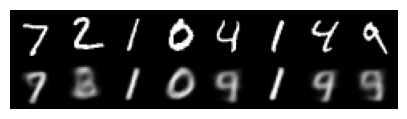
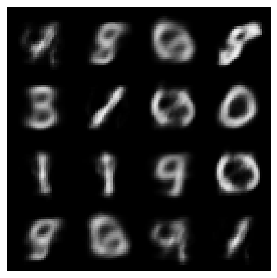
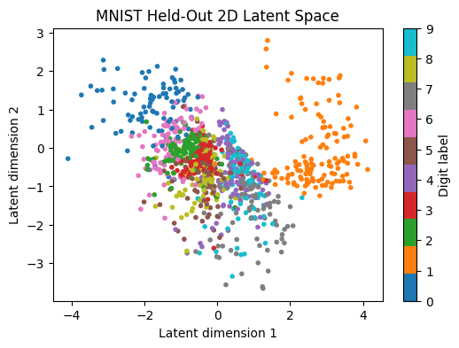

# ETMMGA304 — Lab 1: Variational Autoencoder (VAE) on MNIST

PyTorch implementation of a **Variational Autoencoder (VAE)** with a 2D latent space trained on the MNIST handwritten digits dataset, completed as part of **ETMMGA304: Generative AI and Its Applications** (MCA — AI & ML, K.R. Mangalam University).

## Repository Contents
- `Lab1_VAE_MNIST.ipynb` — Complete executed Google Colab (T4 GPU) notebook (`SEED = 42`).
- `lab_outputs/` — Saved visual evaluation outputs:
  - `vae_reconstructed.png` — Original vs. reconstructed MNIST digits.
  - `vae_generated.png` — 16 novel digits sampled from $\mathcal{N}(0, I)$.
  - `vae_latent.png` — 2D latent space scatter plot on held-out test digits.

## Key Experimental Results (`SEED = 42`, 5 Epochs)
- **Reconstruction Loss (BCE):** Decreased from `188.50` → `155.01`.
- **KL Divergence:** Stabilized at `5.53`.
- **Generation Quality:** `13/16` clearly recognizable digits sampled from the prior.
- **Latent Space Structure:** Clean separation for digits `0` and `1`, with expected overlap in the center for visually similar digits (`4` and `9`).

## Visual Outputs

| Reconstructed Digits | Generated Samples | 2D Latent Space |
| :---: | :---: | :---: |
|  |  |  |

## How to Run
1. Upload `Lab1_VAE_MNIST.ipynb` to [Google Colab](https://colab.research.google.com/).
2. Select **Runtime → Change runtime type → T4 GPU**.
3. Run all cells sequentially to reproduce the training, metrics, and saved plots.

## Author
- **Ashish Raj** — MCA (AI & ML), K.R. Mangalam University
- GitHub: [@AshishRaj5191](https://github.com/AshishRaj5191)
